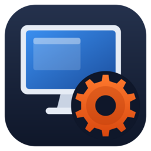

# myRDCcenter

An offline Remote Desktop (RDP) connection manager in Rust. It runs on Windows, Linux and macOS.

All your connections are kept in one encrypted file on your own computer. It has no account, no cloud and no sync.

There are two front-ends. They share the same core and the same vault file, so you can use either one:

| App | Folder | UI toolkit |
|---|---|---|
| `myRDCcenter-egui` | `app-egui` | egui / eframe (glow) |
| `myRDCcenter-slint` | `app-slint` | Slint (Fluent style) |

## Download

Go to [Releases](../../releases):

- **Windows:** `myRDCcenter-egui-windows-x64.zip` or `myRDCcenter-slint-windows-x64.zip`. Each zip holds a single `.exe`. It only needs DLLs that ship with Windows, because the C runtime is linked statically.
- **Linux:** `myRDCcenter-linux-x64.tar.gz`. It contains both apps, an icon and `.desktop` files. To add the apps to your menu, copy the `.desktop` files to `~/.local/share/applications/` and `myRDCcenter.png` to `~/.local/share/icons/`. The apps must be on your `PATH`.
- **macOS:** `myRDCcenter-egui-macos.dmg` or `myRDCcenter-slint-macos.dmg`. These are universal builds for Apple Silicon and Intel. The app has no Apple developer signature. The first time you start it, right-click it and choose **Open**.

## Features

- Groups and subgroups in a collapsible tree (for example `Work` > `Servers`), with search
  - **New group** creates a group inside the selected group
  - Click a group to select it. Click it again to fold it. Groups can be renamed, moved (type `Parent/Name`) and deleted. Deleting a group keeps its connections and moves them up one level.
  - Pick a connection's group in its **Group** field. In the egui app, you can also right-click a connection and choose **Move to group**.
- Host, port, user, domain, password, RD Gateway, screen size, all monitors, clipboard/drive sharing, admin session, notes
- Double-click a connection, or click **Connect**, to start the session
- **Import** existing `.rdp` files, or `.rdm` export files with all their folders
  - RDP entries, folders and usernames are imported. Other entry types (SSH, web, ...) are skipped.
  - Passwords in `.rdm` files are encrypted by the program that made them, so they are not imported. Type them in again.
  - Importing the same file twice does not create duplicates.
- Encrypted backup, change master password, auto-lock after idle time
- **Remember on this computer** (Windows and macOS): tick it once, and the app opens without the master password. The key is protected by your computer login, using Windows DPAPI or the macOS Keychain. Anyone who can sign in to your computer as you can then open the vault. Untick it to ask for the password again. After auto-lock, click **Unlock with my computer login**.

## How Connect works

| OS | Client | Login |
|---|---|---|
| Windows | Built-in Remote Desktop (`mstsc`) | Automatic. The password is stored for 60 seconds as a session-only Windows credential (`TERMSRV/<host>`). |
| macOS | **Windows App** (formerly Microsoft Remote Desktop) from the App Store | Windows App asks for the password. |
| Linux | FreeRDP (`xfreerdp3`, `sdl-freerdp3` or `xfreerdp`), for example `sudo apt install freerdp3-x11` | Automatic. The password is sent on stdin, never on the command line. |

On Windows and macOS, the app writes a temporary `.rdp` file and deletes it again after 60 seconds.

## Security

- The vault file is stored here:
  - Windows: `%LOCALAPPDATA%\myRDCcenter\vault.rdsc`
  - Linux: `~/.local/share/myRDCcenter/vault.rdsc`
  - macOS: `~/Library/Application Support/myRDCcenter/vault.rdsc`
- The key is derived from the master password with Argon2id (64 MiB, 3 passes). Data is encrypted with XChaCha20-Poly1305. The file header is authenticated too.
- The vault is written to a temporary file first and then renamed, so a crash cannot leave a broken vault.
- The master password cannot be recovered. Keep a backup and remember the password.

## Build

Install Rust from https://rustup.rs, then run:

```
cargo build --release
```

The apps are in `target/release/`.

On Linux, you also need these packages: `libwayland-dev libxkbcommon-dev libfontconfig1-dev libgl1-mesa-dev libx11-dev libxcursor-dev libxrandr-dev libxi-dev`.

Run the core tests with `cargo test -p myrdc-core`.

To make a release, push a tag such as `v0.1.0`, or run the **Release** workflow from the Actions tab and enter the tag name. GitHub Actions then builds all the files listed under Download.

## egui flicker

The egui app has settings to stop flicker:

- glow renderer with vsync and no MSAA
- no fade animations and no continuous repaint
- fixed container ids, so changing the selection does not start a new layout pass
- a clear colour that is the same as the panel colour

See the comment at the top of `app-egui/src/main.rs`.
