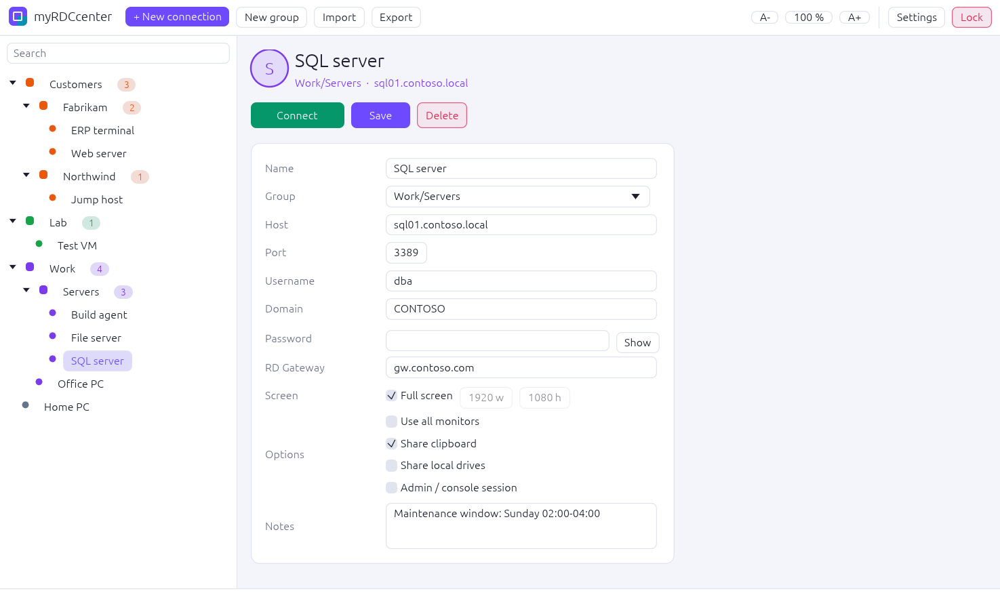
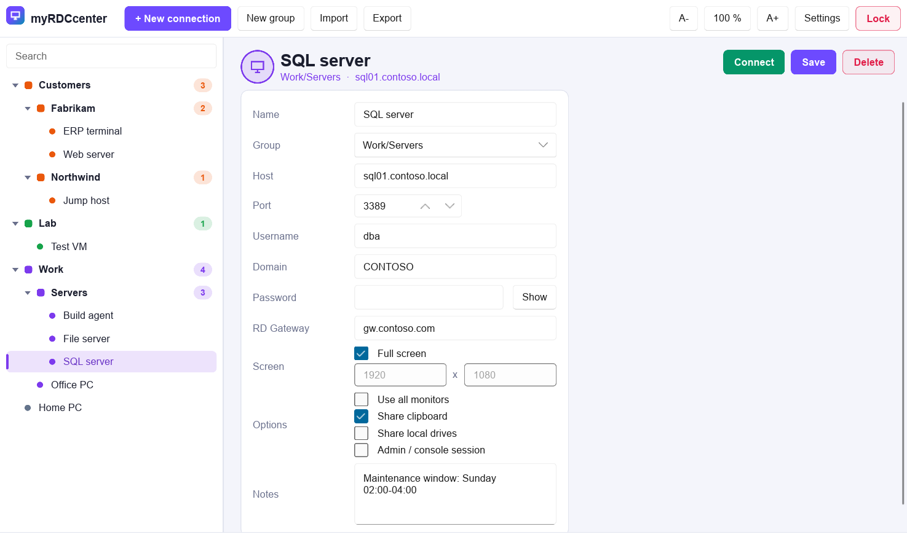

# myRDCcenter

myRDCcenter keeps your Remote Desktop connections in one place and starts them with one click. It runs on Windows, Linux and macOS.

Your connections stay on your computer, in one encrypted file. The app has no account and no cloud.

## Two versions, one vault

There are two versions of the app. They have the same functions and use the same vault file, so you can use either one.

**myRDCcenter-egui**

**myRDCcenter-slint**

## Download

Go to [Releases](../../releases) and download the file for your computer.

| Computer | File |
|---|---|
| Windows | `myRDCcenter-egui-windows-x64.zip` or `myRDCcenter-slint-windows-x64.zip` |
| Linux | `myRDCcenter-linux-x64.tar.gz` (both versions) |
| macOS | `myRDCcenter-egui-macos.dmg` or `myRDCcenter-slint-macos.dmg` |

### Windows

1. Extract the `.zip` file.
2. Double-click the `.exe` file.

### macOS

1. Open the `.dmg` file and drag the app to `Applications`.
2. The first time, right-click the app and click **Open**. The app has no Apple signature, so macOS asks before it starts.
3. Install **Windows App** from the App Store. myRDCcenter uses it to connect.

### Linux

1. Extract the `.tar.gz` file.
2. Install FreeRDP. For example, run `sudo apt install freerdp3-x11`.
3. Start `myRDCcenter-egui` or `myRDCcenter-slint`.

To add the apps to your menu, copy the `.desktop` files to `~/.local/share/applications/`. Copy `myRDCcenter.png` to `~/.local/share/icons/`. The apps must be on your `PATH`.

## First start

1. Start the app.
2. Type a master password two times. Use 8 or more characters.
3. Click **Create vault**.

The master password encrypts the vault. Nobody can recover it. Write it down in a safe place.

## Add a connection

1. Click **+ New connection**.
2. Type a **Name** and the **Host** (the computer name or IP address).
3. Type the **Username**, **Domain** and **Password**, if the remote computer needs them.
4. Click **Save**.

The other fields are optional:

| Field | Use |
|---|---|
| **Group** | Puts the connection in a group. |
| **Port** | Change it only if the remote computer does not use 3389. |
| **RD Gateway** | The gateway server, if your company uses one. |
| **Screen** | **Full screen** fills your monitor. Clear it to set a window size. |
| **Options** | Use all monitors, share the clipboard, share your drives, or start an admin session. |
| **Notes** | Your own notes. |

## Connect

Double-click a connection in the list. You can also select it and click **Connect**.

On Windows and Linux, the app logs in for you. On macOS, Windows App asks for the password.

## Groups

Groups keep the list in order. Each top-level group has its own color. Its subgroups and connections use the same color.

- To make a group, click **New group**. If a group is selected, the new group goes inside it.
- To put a connection in a group, select the group in the **Group** field and click **Save**.
- To fold or open a group, click the arrow. You can also click a selected group again.
- To rename or move a group, select it and click **Rename / move**. Type `Parent/Name` to move it.
- To delete a group, select it and click **Delete group**. Its connections do not go away. They move up one level.

In the egui version, you can also right-click a connection and click **Move to group**.

## Find a connection

Type in the **Search** box. The list shows only the connections that match.

## Import connections

1. Click **Import**.
2. Select one or more files. You can select these types:
   - `.rdp` files from Remote Desktop
   - `.rdm` export files, with their folders
   - `.rdcx` export files from myRDCcenter
3. For an `.rdcx` file, type the password of the file.

If you import the same file again, the app does not make copies.

The app does not import passwords from `.rdp` and `.rdm` files. Type them again.

## Move connections to another computer

1. Click **Export**.
2. Select **All connections** or one group.
3. Type a password for the file two times.
4. Click **Export...** and save the `.rdcx` file.
5. On the other computer, click **Import** and select the file.

The file includes the passwords. It is encrypted with the password that you typed. Select **Move** to remove the connections from this computer after the export.

## Change the text size

The app follows the display scale of Windows or macOS on each screen. To make all text and buttons larger or smaller:

- Click **A+** or **A-** in the toolbar.
- Or press **Ctrl +** or **Ctrl -** (**Cmd** on macOS).

To go back to 100 %, click the percentage between the buttons, or press **Ctrl 0**.

The app keeps the text size on this computer. It does not go into the vault or into exports.

## Keep your vault safe

**Lock** in the toolbar closes the vault. The app asks for the master password again.

The other vault settings are in **Settings**:

| Setting | Use |
|---|---|
| **Backup...** | Saves an encrypted copy of the vault. Do this regularly. |
| **Change password** | Changes the master password. |
| **Remember on this computer** | Opens the vault with your computer login. See below. |
| **Auto-lock after** | Locks the vault after some minutes with no activity. Set it to 0 to stop auto-lock. |

### Remember on this computer

On Windows and macOS, you can open the vault without the master password.

1. Click **Settings**.
2. Select **Remember on this computer**.
3. The next time, the app opens the vault with your computer login.

Anybody who can log in to your computer as you can then open the vault. To stop this, clear **Remember on this computer**.

After an auto-lock, click **Unlock with my computer login**.

## Problems

| Problem | What to do |
|---|---|
| You forgot the master password. | Nobody can open the vault without it. If you know the password of an older backup, copy the backup over the vault file. The [technical notes](docs/TECHNICAL.md#vault-file) show where the vault file is. |
| The text in a full-screen session is too small. | Update to version 0.6.3 or later. |
| On Linux, Connect shows "FreeRDP not found". | Install FreeRDP: `sudo apt install freerdp3-x11`. |
| On macOS, Connect does not open a session. | Install **Windows App** from the App Store. |

## More information

For how the app works inside, how to build it and how to make a release, read [docs/TECHNICAL.md](docs/TECHNICAL.md).

## License

MIT. See [LICENSE](LICENSE).
